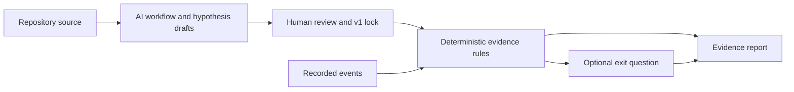

<p align="center">
  
</p>

# GhostReport

**Find what your analytics does not measure.**

GhostReport helps product and engineering teams investigate where users stop in a workflow. It reads source code, maps recorded events, proposes hypotheses for human review, and asks an optional question at eligible exits. Reports keep recorded observations, user statements, and unresolved hypotheses separate.

[Quickstart](#quickstart) · [How it works](#how-it-works) · [ENS case study](#ens-case-study) · [Development](#development) · [Railway deployment](#railway-deployment) · [Documentation](#documentation)

> **Status: Evidence Investigation MVP.** The complete investigation pipeline is demonstrated on a controlled DAO grant application with a simulated wallet. External repository analysis and isolated ENS report simulations are available. Integrating live analytics from arbitrary applications still requires an adapter and reviewed rules.

## Why GhostReport?

A successful wallet connection event tells you that a connection happened. It does not tell you who saw the request, who declined, or why someone left. Missing instrumentation can make different user journeys look identical.

GhostReport brings code evidence, recorded events, and optional feedback into the same investigation:

- **Code references:** workflow states, outcomes, and UI facts link to source files and literal quotes.
- **Reviewable AI output:** workflow, hypothesis, and journey drafts are validated and reviewed before approval.
- **Deterministic counts:** the engine applies rules to events and computes session assignments and reported numbers.
- **A frozen baseline:** v1 is locked before collecting the investigation's probe responses; its digest makes later comparisons auditable.
- **Explicit uncertainty:** reports include coverage, skips, nonresponse, and unresolved findings, using “k of n respondents” or “k of n sessions.”

**Who uses it?** Product teams and researchers review hypotheses, coverage, and findings. Developers connect the application's code and events. An operator reviews AI drafts and controls the investigation; application visitors only encounter an optional, dismissible question.

## What you can try

| Experience            | What it demonstrates                                                                            | Data                                                             |
| --------------------- | ----------------------------------------------------------------------------------------------- | ---------------------------------------------------------------- |
| **DAO Mock**          | Project browsing, a wallet gate, optional exit feedback, and the investigation report           | Visitor events and separately labelled seed/test sessions        |
| **Sandbox**           | Generate traffic, review an investigation, lock v1, add traffic, and inspect the report         | An isolated simulated run owned by the visitor                   |
| **ENS code analysis** | Workflow mapping and instrumentation review of an external repository at a pinned commit        | Source code and manually checked references; no ENS visitor logs |
| **ENS Simulation**    | Apply approved journey rules to generated logs and feedback, then inspect segments and findings | Explicitly synthetic events and answers in a separate run        |

The existing Playwright seed runner drives **DAO Mock**. ENS Simulation generates authored event sequences and feedback; it does not execute ENS or Playwright.

## Quickstart

### Run the prepared demo with Docker

**Requirements:** Git, Docker, and Docker Compose. Host Python and Node installations are not required for this path.

```bash
git clone https://github.com/chanitnan0jr/GhostReport.git
cd GhostReport
GIT_SHA=$(git rev-parse HEAD) docker compose up -d --build
```

Open **[http://localhost](http://localhost)**. The stack starts the engine, all built frontends, the separate roles service, and a gateway on one origin. SQLite data persists in Docker volumes.

Passing `GIT_SHA` lets the image associate the gate instrumentation check with the deployed commit. If verification is unavailable or does not match the run's commit, the report shows it as unverified.

| Local URL              | Purpose                                                       |
| ---------------------- | ------------------------------------------------------------- |
| `/app/`                | Try the DAO grant application                                 |
| `/report/#workflow`    | Inspect the application Workflow Map                          |
| `/report/#segments`    | Explore recorded sessions and cohorts                         |
| `/report/`             | Read the investigation report                                 |
| `/sandbox/`            | Create an isolated simulation                                 |
| `/ens/`                | Read the external ENS code review                             |
| `/report/?project=ens` | Start an ENS synthetic report exercise after journey approval |
| `/report/?operator=1`  | Unlock operator controls with the configured token            |

To try the visitor flow, open a DAO project, select **Apply**, and choose **Not now** without starting a wallet connection. An optional question is offered when the consent, plan window, budget, and session eligibility rules permit it. The report refreshes every three seconds and is available while data is being collected.

If port 80 is occupied:

```bash
GIT_SHA=$(git rev-parse HEAD) DEMO_PORT=8080 docker compose up -d --build
```

Then use `http://localhost:8080`. Stop the stack with `docker compose down`; its named volumes are retained.

### Configure AI and operator access

The prepared investigation can be explored without an LLM API key. Fresh code analysis and AI investigation generation require `DEEPSEEK_API_KEY`.

Create a `.env` file at the repository root when enabling those features:

```dotenv
DEEPSEEK_API_KEY=your-deepseek-api-key
GHOST_OPERATOR_TOKEN=replace-with-a-long-random-value
```

Apply the variables by running the Docker startup command again. Open `/report/?operator=1` and enter your operator token. Keep API keys on the server; use separate production credentials instead of the Compose development defaults.

### Add DAO seed sessions with Playwright

With Node.js 22.13+ and npm installed, run this from the repository root against a running, unseeded demo:

```bash
cd scripts/seed
npm ci
npx playwright install chromium
BASE_URL=http://localhost npm run seed
```

The runner drives the application through browser interactions and records the events it emits. Sessions are labelled **“Simulated users (Playwright) — seed”**, separately from visitors. It skips a run that already contains seed sessions and respects probe eligibility and plan windows.

Use the same public origin in `BASE_URL` when seeding a deployed instance. Leave `GHOST_DB_SEED` unset if you intend to seed through Playwright: that alternative writes synthetic rows directly.

## How it works



1. **Inspect:** build a bounded source context and map workflow states, analytics calls, and UI facts to code references.
2. **Review and lock:** review the investigation, hypotheses, questions, and applicable rules. Store the v1 snapshot and digest.
3. **Collect:** ingest events with session IDs, sequence numbers, and retry-stable event IDs. Offer a dismissible question at eligible exits.
4. **Reconcile:** compute cohorts and response counts, keeping rule observations and self-reports as separate evidence dimensions.
5. **Report:** inspect the summary, hypotheses, findings, coverage, code evidence gaps, policy trace, next actions, and limitations.

The LLM proposes definitions; the engine performs assignments and aggregation. The current report keeps using the original reviewed cohort template. Generated journey definitions are shown as a comparison and do not rewrite the locked baseline.

### Evidence boundaries

- A code reference describes what was found within the searched scope.
- A recorded event is a proxy for an action or UI exposure; it does not establish what a person perceived.
- Missing events support absence-based checks only under the rule's required coverage and instrumentation verification.
- Optional feedback describes respondents. It does not automatically generalize to nonrespondents or everyone who left.
- Synthetic feedback exercises the pipeline. It is not evidence about real ENS visitors.

The design draws on research into software observability, diagnostic query selection, experience sampling, permission attribution, and survey bias. The [core paper review](<GhostReport — Core Paper Review.md>) explains which ideas transfer to this MVP and which assumptions remain untested. Those papers are design influences, not evaluations of GhostReport.

## ENS case study

GhostReport also analysed [`ensdomains/ens-app-v3`](https://github.com/ensdomains/ens-app-v3) at commit [`3c10925f`](https://github.com/ensdomains/ens-app-v3/tree/3c10925fa042568d4affd6897d34e42159abd7a3), an external repository licensed under MIT.

The reviewed scope found a wallet Connect button replacing Next on the Pricing step without an exposure or click event in the searched files. A successful connection is recorded elsewhere. This leaves a gap between seeing the connection request and completing a connection.

- [Pricing button source at the pinned commit](https://github.com/ensdomains/ens-app-v3/blob/3c10925fa042568d4affd6897d34e42159abd7a3/src/components/pages/profile/%5Bname%5D/registration/steps/Pricing/Pricing.tsx#L185)
- [Code-only investigation and human reference review](fixtures/partb/REVIEW.md)
- [ENS journey definitions and approval](docs/reviews/2026-10-16-ens-journeys.md)

The scope was bounded to 16 files and a 30,000-token context cap. The reference review records correct, wrong, and partial checks. This case study demonstrates code analysis; it does not contain production ENS analytics or visitor findings.

### Exercise the ENS report with synthetic feedback

1. Open `/report/?project=ens#segments` and review the proposed journey rules.
2. Use **Review and approve this draft**, unlock operator access, enter a reviewer name, and approve the displayed digest.
3. Open `/report/?project=ens`, select **Start ENS simulation**, and add simulated load and feedback.

You can exercise answers, skips, nonresponse, and questions not shown. Each creator owns a separate run; shared report links are read-only in other browsers. The simulation freezes its journey definitions, question, options, and event paths before load is added.

Approvals saved locally do not transfer to a new deployment automatically. Download the approved fixture and commit it as `fixtures/partb/journeys.ens.json` when packaging it for deployment.

See [ENS Simulation](docs/ENS-Simulation.md) for the API, persistence, limits, and provenance details.

## Development

**Requirements:** Python 3.11+, uv, Node.js 22.13+, npm, and ripgrep. The frontends use React, Vite, and TypeScript; the engine uses FastAPI, SQLite, and DeepSeek for AI stages.

Install dependencies from the repository root:

```bash
uv sync --frozen
npm ci --prefix app
npm ci --prefix console
npm ci --prefix landing
```

To develop the frontends against the Docker backend, keep the stack running and start each Vite server in a separate terminal:

```bash
GHOST_API_TARGET=http://127.0.0.1 GHOST_ROLES_TARGET=http://127.0.0.1 npm --prefix app run dev -- --port 5173
GHOST_API_TARGET=http://127.0.0.1 GHOST_ROLES_TARGET=http://127.0.0.1 npm --prefix console run dev
GHOST_API_TARGET=http://127.0.0.1 GHOST_ROLES_TARGET=http://127.0.0.1 npm --prefix landing run dev
```

Enter through `http://localhost:5175` so app navigation, API requests, and browser storage share one origin. Adjust both targets if the Docker gateway uses another port. Without overrides, Vite targets engine port 18000 and roles port 18100.

For a static frontend preview, each frontend supports `VITE_MOCK=1 npm run dev` from its own directory. ENS mock mode shows a static report whose counts were computed by the backend; it does not generate new data in the browser.

### Collection windows

Prepared runs use the deadlines in their approved probe plans. For a native backend run, the CLI can shorten the collection window relative to the first v1 lock:

```bash
uv run python -m engine.demo serve --run-id local-live --mode live --port 18000 --collection-minutes 12
```

The effective deadline is the earlier of the approved plan deadline and 12 minutes after lock. Restarting an existing run preserves its locked window; it does not extend an expired plan. Review and approve a new plan for a later investigation. The report is available throughout collection, so there is no need to wait for the window to close before reading it.

### Checks

```bash
uv run pytest -q
uv run mypy engine
uv run ruff check engine tests
npm test --prefix app
npm test --prefix console
npm test --prefix landing
npm run build --prefix app
npm run build --prefix console
npm run build --prefix landing
```

Browser checks are documented in the [app](app/README.md) and [console](console/README.md) guides.

### Integrating another repository

[`ghostreport.yaml`](ghostreport.yaml) configures source scope, workflow keywords, analytics function names, and event-name mappings. The analysis CLI writes a draft for review:

```bash
uv run --env-file .env python -m engine.analyze app runs/draft.app.json --config ghostreport.yaml
```

External repositories can be analysed in code-only mode with a target-specific config, as shown in [`fixtures/partb/ghostreport.ens.yaml`](fixtures/partb/ghostreport.ens.yaml). Live event ingestion, probe delivery, and rule applicability need a reviewed integration. There is no published GhostReport npm SDK or general analytics importer yet.

## Railway deployment

The deployment uses three services on one public origin:

| Service                                        | Dockerfile                                               | Health check    | Persistent storage        |
| ---------------------------------------------- | -------------------------------------------------------- | --------------- | ------------------------- |
| `api` — engine and built frontends             | [`Dockerfile`](Dockerfile)                               | `/api/health`   | Its own volume at `/data` |
| `roles` — separate role-assignment process     | [`roles/Dockerfile`](roles/Dockerfile)                   | `/roles/health` | Its own volume at `/data` |
| `gateway` — Caddy routing to private upstreams | [`deploy/gateway/Dockerfile`](deploy/gateway/Dockerfile) | `/api/health`   | None required             |

Keep the repository root as the build context for all three services. Generate the public domain on the gateway and keep the SQLite services at one replica. The gateway routes `/roles/*` to roles and all other paths to the API, preserving the frontend's relative URLs.

Follow the [Railway deployment guide](deploy/gateway/README.md) for exact settings and health checks. The API Dockerfile runs the gate instrumentation check and records the build commit when Railway supplies `RAILWAY_GIT_COMMIT_SHA`.

Configure new services through the Railway dashboard using the Dockerfiles above. The repository's `railway.json` files are legacy configuration: [Railway has deprecated Config as Code](https://docs.railway.com/config-as-code), with existing service support ending on December 1, 2026. This repository does not yet provide the replacement Infrastructure as Code setup.

For existing services using Config as Code, select the service's own file:
[`deploy/api/railway.json`](deploy/api/railway.json),
[`roles/railway.json`](roles/railway.json), or
[`deploy/gateway/railway.json`](deploy/gateway/railway.json).
The former root `/railway.json` has moved to `/deploy/api/railway.json` so its API
build settings are not automatically selected for other services. Update that
path on any legacy API service before deploying this change.

## Project layout

| Directory                        | Responsibility                                                           |
| -------------------------------- | ------------------------------------------------------------------------ |
| [`engine/`](engine/)             | Source analysis, validation, ingestion, policy, reports, and simulations |
| [`app/`](app/)                   | The controlled DAO grant application and simulated wallet                |
| [`console/`](console/)           | Workflow Map, Segments, Report, and operator controls                    |
| [`landing/`](landing/)           | Home, recorded demos, ENS review, installation, and sandbox entry        |
| [`shared/`](shared/)             | Shared header, navigation, and design assets                             |
| [`roles/`](roles/)               | Role assignment in a separate process and database                       |
| [`prompts/`](prompts/)           | Versioned AI-stage prompts                                               |
| [`fixtures/`](fixtures/)         | Prepared investigations, sample reports, and ENS review artifacts        |
| [`scripts/seed/`](scripts/seed/) | DAO Playwright seed sessions and recordings                              |
| [`tests/`](tests/)               | Engine and integration checks                                            |
| [`deploy/`](deploy/)             | Local and Railway gateway configuration                                  |

## Roadmap

The current MVP demonstrates the investigation pipeline. The longer-term direction is a reusable investigation layer across applications, codebases, and analytics systems:

- Repository and analytics integrations.
- Configurable cohorts grounded in recorded evidence.
- Adaptive selection of diagnostic questions and telemetry checks.
- Continuous investigations with traceable evidence and versioned decisions.

These are platform goals, not claims that arbitrary applications are supported today.

## Documentation

- [System design](<GhostReport v5 — System Design.md>) — contracts, workflow, guards, and integration levels.
- [Core paper review](<GhostReport — Core Paper Review.md>) — research influences, assumptions, and limits of transferring those findings to this demo.
- [User and setup guide in Thai](docs/PROJECT_GUIDE.th.md) — shell setup, collection windows, operator workflows, and detailed usage.
- [ENS Simulation](docs/ENS-Simulation.md) — generated events and feedback, isolation, and API contracts.
- [App guide](app/README.md) · [Console guide](console/README.md) · [Landing guide](landing/README.md).
- [Railway gateway guide](deploy/gateway/README.md).

## Contributing

Use [GitHub Issues](https://github.com/chanitnan0jr/GhostReport/issues) to describe a workflow, integration need, or reproducible problem. Include the run mode, relevant commit, expected behaviour, and actual result; omit API keys, tokens, and private user data.

For changes, keep code references reviewable, add appropriate checks, preserve the separation between synthetic and visitor data, and describe how the change affects evidence or report interpretation.
