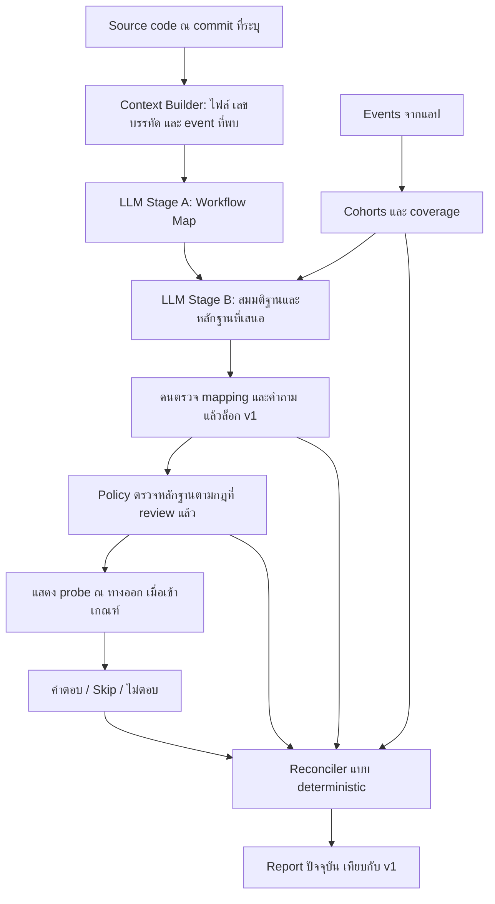

# GhostReport — คู่มือเข้าใจโปรเจคและเริ่มใช้งาน

อิง source code และเอกสารใน repository วันที่ 15 ตุลาคม 2026

เอกสารนี้อธิบายทั้งแนวคิดของผลิตภัณฑ์และวิธีใช้ prototype ที่มีอยู่จริง คำสั่งรันจาก root ของ GhostReport บน Bash เว้นแต่ระบุเป็นอย่างอื่น

**เส้นทางอ่าน:** [ภาพรวม](#overview) → [Paper](#research) → [ติดตั้งเดโม](#quickstart) → [วิเคราะห์จริง](#live) → [กำหนดเวลา](#timing) → [อ่าน Report](#report) → [เชื่อม repo](#integration)

<a id="overview"></a>

## 1. GhostReport คืออะไร

GhostReport คือเครื่องมือสืบสวนพฤติกรรมผู้ใช้สำหรับทีมที่มีทั้ง source code และ event แต่ยังตอบไม่ได้ว่าทำไมผู้ใช้หยุดอยู่ตรงขั้นตอนหนึ่ง

ตัวอย่างใน MVP คือแอปสมัครทุน DAO ผู้ใช้เปิดดูโครงการ กด Apply แล้วพบว่าต้องเชื่อม wallet บางคนออกไปโดยไม่ได้เริ่มเชื่อม การเห็น event ว่าไม่ได้กด Connect ยังแยกไม่ได้ว่าคนนั้น:

- ไม่รู้มาก่อนว่าต้องมี wallet
- กังวลต่อข้อความขอสิทธิ์ที่เพิ่งเห็น
- ไม่แน่ใจว่าใครเป็นผู้ขอสิทธิ์
- แค่เข้ามาดูโครงการ และไม่ได้ตั้งใจสมัคร
- มีเหตุผลอื่นที่ทีมยังไม่ได้เสนอ

ระบบจึงนำโค้ดและ event มาเป็นบริบทให้ LLM เสนอสมมติฐาน จากนั้นใช้กฎที่ทีมกำหนดตรวจหลักฐาน และเสนอคำถามสั้น ๆ ที่ผู้ใช้ข้ามได้ เมื่อคำตอบเข้ามา Report จะปรับตามหลักฐาน พร้อมบอกสิ่งที่ยังไม่ทราบ

**ผลลัพธ์ที่ทีมควรได้:** รู้ว่ามีหลักฐานรองรับคำอธิบายไหน ข้อมูลขาดตรงไหน และควรลงมือเก็บ event หรือปรับประสบการณ์ตรงไหนต่อ การจะรู้ว่าการแก้ UI ทำให้ conversion ดีขึ้นจริงยังต้องมีการทดลองเพิ่มเติม

### ใครเป็นคนใช้

| คน                              | ใช้ทำอะไร                                                                  | ต้องมีอะไร                                                          |
| ------------------------------- | -------------------------------------------------------------------------- | ------------------------------------------------------------------- |
| Product manager / founder       | ดูว่าคำอธิบายของ drop-off มีหลักฐานแค่ไหน และจัดลำดับงานต่อ                | เข้าถึง Report และมี developer ช่วยต่อข้อมูล                        |
| UX researcher / product analyst | ตรวจคำถาม ประชากรที่ถูกถาม coverage และ nonresponse                        | เข้าใจ workflow และขอบเขตของกลุ่มตัวอย่าง                           |
| Developer / ทีม dApp            | ให้ระบบอ่านโค้ด map events และตรวจจุดที่ instrumentation ยังตอบคำถามไม่ได้ | checkout ของ repo และสิทธิ์เข้าถึง event ที่จะใช้                   |
| Operator                        | รัน Analyze ตรวจ draft อนุมัติ mapping/คำถาม ล็อก v1 และบันทึก snapshot    | เครื่องที่รัน engine, API key เมื่อต้องเรียก LLM และ operator token |
| ผู้ใช้แอป / ผู้ลองเดโม          | ใช้แอปตามปกติ และเลือกตอบหรือข้ามคำถามเพิ่มเติม                            | Browser; ไม่ต้องมี API key หรือ wallet จริง                         |

ในทีมเล็ก คนเดียวอาจเป็นทั้ง product, developer และ operator ส่วนผู้ใช้แอปไม่จำเป็นต้องเปิด console หรือเข้าใจกลไกการสืบสวน

### ขอบเขตของ MVP

ปัจจุบันทดลองกับ **Micro Wallet Flow** ที่ทีมสร้างเอง ส่วนการอ่านโค้ดที่ทีมไม่ได้เขียนใช้ repo wallet/dApp แบบ read-only ได้ Workflow อื่น เช่น KYC หรือการผูกบัญชีเป็นทิศทางนำไปปรับใช้ ไม่ใช่ integration ที่พร้อมใช้โดยไม่ปรับกฎ

<a id="research"></a>

## 2. แนวคิดเบื้องหลังจากงานวิจัย

งานเหล่านี้เป็นที่มาของการออกแบบแต่ละส่วน ไม่ใช่ผลการประเมินว่า GhostReport ทำงานได้ดีกว่าเครื่องมืออื่น ข้อเชื่อมโยงกับผลิตภัณฑ์ในคอลัมน์กลางเป็นการประยุกต์ของทีม

| งานวิจัย                                                                                                                                                                        | แนวคิดที่นำมาใช้ใน GhostReport                                                                                                          | ขอบเขตที่ต้องรักษา                                                                                                                                                                                |
| ------------------------------------------------------------------------------------------------------------------------------------------------------------------------------- | --------------------------------------------------------------------------------------------------------------------------------------- | ------------------------------------------------------------------------------------------------------------------------------------------------------------------------------------------------- |
| [Tao et al., 2026](https://arxiv.org/abs/2607.05785v1)                                                                                                                          | การมี logging ไม่รับประกันว่ามีหลักฐานที่ใช้วินิจฉัยได้ จึงอ่าน code path ควบคู่กับ instrumentation และมองหาคำถามที่ event ยังตอบไม่ได้ | ศึกษา observability ของระบบซอฟต์แวร์ ไม่ได้พิสูจน์ความสามารถในการเข้าใจ intent ของผู้ใช้ วิธี strip-and-restore เป็นแนวทางประเมินในอนาคตของโครงการ                                                |
| [Rodler, 2018](https://easychair.org/publications/paper/zHgj/open)                                                                                                              | มองการเลือกหลักฐานเป็นการเลือกคำถามที่ช่วยแยกสมมติฐาน มีวิธีอย่าง SPL₁.₁ ที่ไม่ต้องอาศัย prior ที่สมเหตุสมผล                            | ผลทางทฤษฎีมีข้อสมมติเรื่อง binary queries และ oracle ที่ตอบถูก เหตุผลของคนซ้อนกันได้ จึงไม่ใช้คำตอบ probe ตัดสมมติฐาน ใน MVP gate check ไม่คำนวณ SPL₁.₁ เพราะยังไม่มี partition สองฝั่งที่เหมาะสม |
| [Baxter, 2014](https://research.google/pubs/esm-versus-logs-filling-in-the-gaps/)                                                                                               | พฤติกรรมที่บันทึกได้อาจขาดบริบทของผู้ใช้ จึงเปิดให้มีข้อมูลจากผู้ใช้เพิ่มเติม                                                           | เป็น abstract ของ conference presentation และ ESM ที่อธิบายมีขนาดต่างจาก probe สั้นของเรา จึงไม่ใช่หลักฐานว่า probe แบบนี้ได้ผล                                                                   |
| [Harbach & Johnson, 2026](https://research.google/pubs/who-am-i-talking-to-a-large-scale-measurement-of-surface-attribution-across-real-world-security-and-privacy-interfaces/) | ปัญหาการระบุแหล่งที่มาของ UI เป็นแรงบันดาลใจของตัวเลือก “Not sure who is asking”                                                        | ศึกษาผ่าน vignette surveys ไม่ใช่การใช้งาน crypto wallet จริง ตัวเลือกที่เพิ่มเป็น design hypothesis ของทีม และ mock popup ในเว็บต่างจาก extension                                                |
| [Bethlehem, 2010](https://dare.uva.nl/id/73f3f091-40be-41b4-8f0a-debd8c5b4259)                                                                                                  | ต้องรายงานทั้งคนที่มีโอกาสถูกถาม คนที่ไม่ตอบ และกลุ่มที่สรุปผลถึงได้                                                                    | การเขียน k of n ช่วยให้เห็นฐานนับ แต่ไม่ได้กำจัด self-selection bias ผู้ที่ออกก่อนเห็นคำถามอาจต่างจากผู้ตอบ                                                                                       |
| [Borlund, 2003](https://informationr.net/ir/8-3/paper152.html)                                                                                                                  | ใช้สถานการณ์สั้น ๆ ให้ผู้ลองเดโมสวมบทบาทและตัดสินใจเอง เช่น ผู้หาทุนกับผู้สำรวจชุมชน                                                    | หลักฐานมาจาก information retrieval การนำ role card มาใช้กับ wallet onboarding เป็นการประยุกต์ ไม่ใช่หลักฐานแทนพฤติกรรมผู้ใช้จริงในตลาด                                                            |

แหล่งที่ตรวจสำหรับคู่มือนี้: หน้า abstract ของ Tao, Baxter, Harbach & Johnson และ Bethlehem; ฉบับเต็มของ Rodler และ Borlund การตีความฉบับเต็มของทีมและรายละเอียดแผนประเมินเพิ่มเติมอยู่ใน [Core Paper Review](<../GhostReport — Core Paper Review.md>)

### หลักการที่ตามมาจากแนวคิดเหล่านี้

1. **ไม่พบ ไม่เท่ากับไม่มี:** ไม่พบ tracking ในไฟล์ที่ค้นไม่ได้แปลว่าทั้ง repo ไม่มี tracking; ไม่พบ event ไม่ได้แปลว่าหน้านั้นไม่เคยแสดง
2. **บอกที่มาของข้อสรุป:** แยกสิ่งที่สังเกตจาก event, สิ่งที่อ่านจากโค้ด, คำตอบของผู้ใช้ และคำแนะนำ
3. **เปิดให้มีหลายเหตุผล:** เลือกคำตอบได้หลายข้อและมี Something else เสมอ
4. **รายงานความไม่แน่ใจ:** คำตอบน้อยกว่า 3 เป็น Unresolved และเมื่อคำตอบกับ observation ขัดกันให้แสดงทั้งสองด้าน
5. **ตรวจย้อนกลับได้:** เก็บ baseline ก่อนถาม พร้อม digest ที่ส่งให้อีกคนถือไว้ และบันทึก decision trace

โครงการอ้างได้ว่ากำลังสร้างและตรวจวงจรเก็บหลักฐานที่ตรวจย้อนได้ การจะอ้างว่า policy ถามน้อยกว่า survey ธรรมดาโดยได้คุณภาพเท่าเดิมยังต้องมีการประเมินเปรียบเทียบเพิ่ม

<a id="architecture"></a>

## 3. ระบบทำงานตั้งแต่ต้นจนได้ Report อย่างไร



### งานของ AI กับงานของกฎต่างกันอย่างไร

| ส่วน                | ทำอะไร                                                                              |
| ------------------- | ----------------------------------------------------------------------------------- |
| Context Builder     | ค้นไฟล์และ import ใกล้เคียง เตรียมโค้ดที่มีเลขบรรทัด พร้อมระบุขอบเขตที่ค้น          |
| Stage A — LLM       | เสนอ states, outcomes และ UI facts โดยอ้าง file, lines และ quote                    |
| Stage B — LLM       | เสนอ hypotheses, action จาก catalog และตัวเลือก probe                               |
| Guards + คนตรวจ     | ตรวจ reference/schema/scope และอนุมัติ class mapping กับคำถามก่อนใช้งาน             |
| Policy + Reconciler | ใช้กฎที่กำหนดไว้ ตัดสินใจเรื่องหลักฐานและคำนวณสถานะ Report โดยไม่เรียก LLM ต่อคำตอบ |
| Console             | อ่าน facts JSON และแสดง Report; ไม่คำนวณเหตุผลใหม่เอง                               |

ใน flow ที่รันผ่าน console การ Analyze ใช้ cohort ปัจจุบันประกอบ ส่วน `engine.analyze` แบบ CLI ใช้บริบทว่าไม่มี live data หรือ code-only ตาม option ที่เลือก จึงไม่ควรนำ draft จาก CLI ไปอ้างว่ามีพฤติกรรมจริงรองรับแล้ว

### จุดตัดสินใจในแอป

- **DP0:** engine ตรวจ telemetry ทุก 30 วินาที และไม่เลือกตรวจ action เดิมซ้ำบน data version เดิม
- **DP1:** ผู้ใช้กด Not now จาก wallet gate
- **DP2:** ผู้ใช้ย้อนจากหน้าโครงการ

แผน DP1/DP2 โหลดล่วงหน้าเมื่อเข้า ProjectPage ตอนออกใช้การตรวจ eligibility ในเครื่อง ไม่รอ LLM หรือ network ก่อนปิด modal/ย้อนหน้า ผู้ใช้ที่ไม่ยินยอมรับคำถาม เคยถูกถามแล้ว เปิด wallet popup อยู่ หรือไม่เข้า cohort ของแผนจะไม่ถูกถาม

### ชิ้นส่วนและเส้นทางเข้าใช้งาน

| ส่วน          | หน้าที่                                              | Local development                |
| ------------- | ---------------------------------------------------- | -------------------------------- |
| Landing       | เริ่ม session แจก role card และแสดงขั้นตอนการลองระบบ | `http://localhost:5175/`         |
| Target app    | แอปขอทุนและ mock wallet ที่มี event/probe            | เข้าผ่าน `/app/` บน 5175         |
| Console       | Report สาธารณะและ operator controls                  | เข้าผ่าน `/report/` บน 5175      |
| Engine        | FastAPI, LLM harness, policy, SQLite และ Report API  | `http://127.0.0.1:18000/api/*`   |
| Roles service | แจกบทบาทและเก็บ assignment ใน DB แยก                 | `http://127.0.0.1:18100/roles/*` |

การเข้าผ่าน landing port เดียวทำให้ session highlight และ sendBeacon ใช้ origin เดียวกัน ข้อมูลที่ส่งให้ engine มี session ID แต่ไม่มี role

## 4. เลือกวิธีเริ่มใช้งาน

| วิธี                                                      | เหมาะกับ                                                                       | ต้องใช้ LLM key ไหม                            |
| --------------------------------------------------------- | ------------------------------------------------------------------------------ | ---------------------------------------------- |
| **Frontend mock** — `VITE_MOCK=1`                         | ดูหน้าจอ/ลอง interaction โดยไม่เปิด backend                                    | ไม่ต้อง; ข้อมูลอยู่ใน mock ไม่ใช่ผล engine     |
| **Prepared demo** — `engine.demo serve`                   | ทดลองวงจรจริงด้วย investigation ที่อนุมัติไว้แล้ว เพิ่ม seed ด้วย `--seed` ได้ | ไม่ต้อง                                        |
| **New investigation** — Analyze → Review → Approve → Lock | ให้ LLM อ่าน repo ปัจจุบันใหม่ แล้วเก็บหลักฐานของ run ใหม่                     | ต้องมี DeepSeek key                            |
| **Code-only** — CLI `--code-only`                         | อ่าน repo โดยยังไม่มี events หรือ probe integration                            | ต้องมี key เมื่อไม่มี cache; ผลเป็น draft JSON |

หน้าเว็บที่ติดป้าย SEED DATA, DEMO หรือ REPLAY ต้องอ่านตามที่มาของข้อมูล โดยเฉพาะ demo ที่รวม seed กับผู้เยี่ยมชม ห้ามตีความจำนวนรวมเป็นผู้ใช้จริงทั้งหมด

<a id="quickstart"></a>

## 5. Quick Start: ติดตั้งผ่าน Shell แล้วเปิดเดโม

### ขั้นที่ 1 — เตรียมเครื่องและ dependency

ต้องมี Git, Python 3.11 ขึ้นไป, uv, Node.js 22.13 ขึ้นไปพร้อม npm และ ripgrep (`rg`) จากนั้น clone repo หรือเข้า checkout ที่มีอยู่:

```bash
git clone https://github.com/chanitnan0jr/GhostReport.git
cd GhostReport
```

รัน block นี้ใน Bash จาก root ของ repo:

```bash
set -euo pipefail
uv sync --frozen
for frontend in app console landing; do
  npm ci --prefix "$frontend"
done
mkdir -p runs
```

นี่คือขั้นตอน setup ผ่าน Shell ที่ใช้คำสั่งปัจจุบันของโครงการ **repo ยังไม่มี `scripts/setup.sh` สำหรับติดตั้งทุกอย่างในคำสั่งเดียว** จึงไม่ต้องค้นหรือเรียกไฟล์ชื่อนั้น

### ขั้นที่ 2 — เตรียม operator token

สร้างหรือแก้ไฟล์ `.env` ที่ root ของ repo โดยเก็บ token แบบสุ่มยาวที่ทีมเลือกไว้:

```dotenv
GHOST_OPERATOR_TOKEN=replace-with-a-long-random-operator-token
```

ใช้ token นี้กรอกหน้า operator ภายหลัง แฟ้ม `.env` ถูก ignore จาก Git อยู่แล้ว ตัวอย่างนี้เป็น placeholder ต้องเปลี่ยนก่อนใช้งานจริง

สำหรับ prepared demo **ยังไม่ต้องใส่ API key** เพราะไม่ได้รัน Stage A/B ใหม่

### ขั้นที่ 3 — เปิด roles service ใน terminal แยก

สร้างไฟล์ `runs/roles.env` สำหรับ service นี้โดยเฉพาะ:

```dotenv
ROLES_SEED=replace-with-a-different-stable-random-secret
ROLES_DB=runs/roles.sqlite
```

เปลี่ยน seed เป็นค่าลับแบบสุ่ม และเก็บค่าเดิมไว้เมื่อใช้ DB เดิม จากนั้นเปิด service:

```bash
uv run --env-file runs/roles.env uvicorn roles.service:app --port 18100
```

โฟลเดอร์ `runs/` ถูก ignore จาก Git ด้วย การแยก env นี้ทำให้ไม่ต้องส่ง roles seed เข้า process ของ engine

### ขั้นที่ 4 — ตรวจ instrumentation และเปิด engine

ใน terminal ใหม่ จาก root เดิม:

```bash
uv run python -m engine.demo verify
uv run --env-file .env python -m engine.demo serve \
  --run-id local-demo \
  --mode demo \
  --port 18000 \
  --seed
```

- ใช้ `fixtures/investigation.app.json` ที่อนุมัติไว้แล้ว และล็อก v1 ให้อัตโนมัติ
- `--seed` เพิ่มข้อมูลสังเคราะห์ 20 sessions หลังล็อก และไม่เติมซ้ำทุกครั้งที่เปิด run เดิม
- run เดิมเก็บใน `runs/local-demo.sqlite` การ restart ไม่ได้เริ่มการทดลองใหม่
- digest ของ v1 แสดงใน log และหน้า operator ต้องส่งให้อีกคนถือก่อนรับ probe แรก เพื่อมีหลักฐาน baseline อยู่นอกระบบ
- ถ้าขึ้น warning ว่า code refs ไม่ตรง ให้ทำ New investigation ตามบทถัดไปก่อนใช้ผล code evidence เป็นหลักฐานของ build ปัจจุบัน

**วันหมดอายุของแผน:** prepared fixture เป็นข้อมูลของงาน hackathon และมี `ends_at` ที่ระบุไว้ตายตัว หากเปิดหลังเวลานั้น หน้าแอปและ Report ยังเปิดได้ แต่ไม่แสดง probe ใหม่ ต้องเตรียม investigation/คำถามที่มี deadline ใหม่ ไม่ใช่แค่ restart run

### ขั้นที่ 5 — เปิด frontend สาม terminal

แต่ละคำสั่งรันจาก root ของ repo ในคนละ terminal:

```bash
npm --prefix app run dev
```

```bash
npm --prefix console run dev
```

```bash
npm --prefix landing run dev
```

ค่า proxy เริ่มต้นถูกตั้งไว้แล้ว:

| Path     | Environment override | Default                  |
| -------- | -------------------- | ------------------------ |
| `/api`   | `GHOST_API_TARGET`   | `http://127.0.0.1:18000` |
| `/roles` | `GHOST_ROLES_TARGET` | `http://127.0.0.1:18100` |

ถ้าเปลี่ยน port ให้ตั้ง target ใน frontend ทั้งสาม เช่น:

```bash
GHOST_API_TARGET=http://127.0.0.1:18001 \
GHOST_ROLES_TARGET=http://127.0.0.1:18101 \
npm --prefix landing run dev
```

ทำแบบเดียวกันกับคำสั่งของ app และ console เมื่อต้อง override ส่วนหน้า app/report ของ landing proxy ไปยัง dev servers ที่ 5173/5174

### ขั้นที่ 6 — เริ่มลองและเปิด Report

1. เปิด `http://localhost:5175/`
2. กด **Try the app as a user** ระบบสร้าง session ID เรียก roles service และแสดง role card
3. กด **Start** แล้วใช้แอปตามบทบาทของตัวเอง; ในแอปเลือกได้ว่าจะรับคำถามเพิ่มเติมหรือไม่
4. สำหรับ operator ที่ต้องการ smoke check ให้ใช้ session ทดสอบใหม่: เปิดโครงการ → Apply → Not now → ตอบหรือ Skip เพื่อเห็นการเปลี่ยนแปลง
5. เปิด `http://localhost:5175/report/` จะมี **Your session** เมื่อ browser มี session ID จาก landing และ engine รับกิจกรรมแล้ว
6. หน้า operator อยู่ที่ `http://localhost:5175/report/?operator=1` กรอก token จาก `.env` เครื่องมือจะส่ง Bearer token เฉพาะ operator requests

Report refresh ทุก 3 วินาที การเลือก Skip เพิ่มจำนวน skipped แต่ไม่เปลี่ยน self-report ของสมมติฐาน

ดู health ของ service ได้จาก:

```bash
curl --fail http://127.0.0.1:18000/api/health
curl --fail http://127.0.0.1:18100/roles/health
```

หากต้องการดูเฉพาะหน้าจอ ให้เติม `VITE_MOCK=1` หน้าคำสั่ง dev ของแต่ละ frontend Mock แต่ละตัวทำงานอิสระ ไม่ใช่การทดสอบวงจรกับ engine จริง

<a id="live"></a>

## 6. ตั้ง API key แล้วสร้าง investigation ใหม่

เส้นทางนี้เหมาะกับการทดลองโค้ดปัจจุบันและกำหนดรอบรับคำตอบใหม่ ต้องเปิด roles และ frontend ตาม Quick Start อยู่แล้ว

### ขั้นที่ 1 — ตั้ง key ฝั่ง server

เพิ่มลงใน `.env` เดิม:

```dotenv
DEEPSEEK_API_KEY=replace-with-your-server-side-api-key
GHOST_OPERATOR_TOKEN=replace-with-a-long-random-operator-token
GHOST_MODEL=deepseek-flash
GHOST_THINKING=0
```

model/thinking ในตัวอย่างเป็นค่าตาม harness ปัจจุบัน เปลี่ยนตามรุ่นที่บัญชี API ใช้ได้ และล็อกค่าที่ใช้เมื่อเก็บผลประเมิน Key ใช้ในเครื่องที่รัน engine/CLI เท่านั้น ไม่ต้องให้ผู้ลองแอปกรอก

`engine/llm.py` อ่าน `DEEPSEEK_API_KEY` จาก environment หรือ root `.env` ได้ แต่ env อื่นต้องโหลดให้ process ด้วย ตัวอย่างจึงใช้ `uv run --env-file .env` ห้ามใส่ API key, operator token หรือ roles seed ในตัวแปร `VITE_*` เพราะค่ากลุ่มนี้อาจเข้า client bundle

### ขั้นที่ 2 — เปิด run ใหม่ที่ยังไม่ล็อก และกำหนดเวลา

หยุดเฉพาะ engine ที่เปิดเองใน terminal ก่อนหน้า ถ้ากำลังใช้ port 18000 อยู่ จากนั้นรัน:

```bash
# ให้ deadline เริ่มต้นของคำถามอยู่ในอนาคต
export GHOST_ENDS_AT="$(uv run python -c 'from datetime import UTC, datetime, timedelta; print((datetime.now(UTC) + timedelta(days=1)).isoformat())')"

GHOST_RUN_ID=local-live-01 \
GHOST_MODE=live \
GHOST_COLLECTION_MINUTES=12 \
uv run --env-file .env uvicorn engine.api:app --port 18000
```

ใช้ run ID ใหม่ทุก investigation หาก `local-live-01` เคยล็อกแล้ว ให้เปลี่ยนเป็นชื่อใหม่ เช่น `local-live-02` ข้อมูลแต่ละ run อยู่คนละ SQLite file

คำสั่งนี้ไม่ seed และไม่ auto-lock ต่างจาก `engine.demo serve` จึงเปิด Analyze/Approve ได้ก่อนล็อก เวลา 12 นาทีจะเริ่มนับ **ตอน Lock v1** ไม่ใช่ตอน start server

### ขั้นที่ 3 — Analyze และตรวจ draft บนเว็บ

1. เปิด `/report/?operator=1` ผ่าน landing origin แล้วกรอก token
2. กด **Analyze** ให้ Stage A/B อ่าน repo และเขียน draft การรันนี้เรียก LLM จริงและอาจมีค่าใช้จ่าย
3. ตรวจ file/lines/quote, ขอบเขตไฟล์ที่ค้น, hypotheses, class mapping และตัวเลือก DP1/DP2 โดยย้อนดูโค้ดจริง
4. ถ้ายังไม่เหมาะสม ให้แก้ input/config หรือให้ทีมแก้และ review draft ก่อน ไม่อนุมัติเพียงเพราะผ่าน schema
5. กด **Approve** เมื่อรับรองคำถามและ mapping แล้ว
6. กด **Lock v1** จากนั้นส่ง full digest ให้ reviewer/mentor ถือไว้นอกระบบก่อนเริ่มเก็บคำตอบ

หน้า operator ปัจจุบันอนุมัติ draft ที่ส่งมา ยังไม่มี editor ให้แก้ทุก field บนหน้าเว็บ หากต้องแก้รายละเอียดใช้ CLI/file workflow ด้านล่าง เมื่อ lock แล้วเปลี่ยน hypotheses ของ run นั้นไม่ได้ ต้องเปิด run ใหม่

### ขั้นที่ 4 — เปิดให้ผู้ใช้ลอง และดู Report

เปิด landing ให้ผู้ใช้เริ่ม session ใหม่ แผนคำถามจะถูกโหลดเมื่อเข้า ProjectPage และตรวจ eligibility ซ้ำตอนออก Operator เปิด Report ดูการเปลี่ยนแปลงได้ทันทีระหว่างรอบ

ถ้าต้องการบันทึกผลปัจจุบันเป็น snapshot ให้ operator วาง digest ที่เก็บไว้นอกระบบลงในช่อง **Digest held outside the system** แล้วกด **Write v2 snapshot** ช่องนี้ไม่เติม digest ให้อัตโนมัติ หาก digest ไม่ตรง API จะคืน 409

### ทางเลือก: เตรียม investigation ด้วย CLI

ใช้เมื่อต้อง review JSON โดยตรง หรือเตรียม fixture สำหรับเดโม แทนการกด Analyze/Approve บนเว็บ:

```bash
uv run --env-file .env python -m engine.analyze \
  app runs/draft.app.json --config ghostreport.yaml
```

ตรวจ `runs/draft.app.json` ก่อน คำสั่งถัดไปคือการอนุมัติ draft ที่ตรวจแล้วจริง และสร้าง fixture ไม่ใช่คำสั่งที่ควรรันอัตโนมัติต่อโดยไม่อ่าน:

```bash
uv run python -m engine.demo prepare \
  --draft runs/draft.app.json \
  --out fixtures/investigation.app.json \
  --approved-by local-operator \
  --ends-at "$(uv run python -c 'from datetime import UTC, datetime, timedelta; print((datetime.now(UTC) + timedelta(days=1)).isoformat())')"
```

จากนั้นตรวจและ commit source/fixture ที่จะใช้ แล้วรัน `engine.demo verify` บน commit สุดท้าย ก่อนเปิดด้วย `engine.demo serve` ใหม่ การ prepare fixture ไม่ได้แทนที่ v1 ของ run ที่ล็อกอยู่แล้ว

<a id="timing"></a>

## 7. กำหนดเวลาอย่างไร และต้องรอนานเท่าไร

| ค่า                           | ความหมาย                                                                       | ตั้งที่ไหน                                                                  |
| ----------------------------- | ------------------------------------------------------------------------------ | --------------------------------------------------------------------------- |
| `GHOST_COLLECTION_MINUTES=12` | กำหนดหน้าต่างรับคำตอบให้จบหลัง lock 12 นาที สำหรับ server ที่เปิดแบบยังไม่ล็อก | environment ของ engine ก่อนเริ่ม run                                        |
| `--collection-minutes 12`     | หน้าต่างเดียวกันสำหรับ prepared run ที่ auto-lock ตอนเริ่ม                     | option ของ `engine.demo serve`                                              |
| `ends_at`                     | เวลาปิดคำถามแบบ absolute ต้องมี timezone                                       | `prepare --ends-at`, หรือค่า default ที่ API Approve ใช้จาก `GHOST_ENDS_AT` |
| `target_n`                    | เป้าหมายจำนวนคำตอบต่อแผน; default 10                                           | ตอนอนุมัติแผนผ่าน API; UI ปัจจุบันใช้ default                               |
| `budget`                      | เป้าหมายเพดานจำนวน exposure ต่อแผน; default 30                                 | ตอนอนุมัติแผนผ่าน API; UI ปัจจุบันใช้ default                               |
| 3 วินาที                      | รอบ polling ของ Report                                                         | console; ไม่ใช่ระยะเก็บข้อมูล                                               |
| 30 วินาที                     | รอบตรวจ DP0                                                                    | engine                                                                      |

**เวลาปิดจริงคือค่าที่เร็วกว่า** ระหว่าง `ends_at` ของแผนกับเวลา lock + collection window การตั้ง window ใหม่จึงไม่ทำให้ fixture ที่หมดอายุแล้วกลับมาเปิด และการ restart run เดิมไม่เริ่มนับเวลาใหม่

เมื่อได้คำตอบถึง target หรือแสดงถึง budget server จะไม่แจกแผนใหม่ อย่างไรก็ตาม client ที่โหลดแผนก่อนหน้านั้นอาจแสดงต่อได้ก่อน `ends_at` ทำให้ target/budget เกินได้ MVP ไม่มี budget reservation ที่รับประกันเพดานพร้อมกันทุก client

สิ่งที่ควรคาดหวังตามลำดับ:

1. **หลัง server พร้อม:** เปิด Report ได้แล้ว อาจเป็นข้อมูล seed หรือยังไม่มีคำตอบ
2. **หลัง Analyze:** ได้ draft; เวลาเสร็จขึ้นกับ LLM/network ไม่รับประกัน SLA
3. **หลัง Lock:** เริ่มช่วงรับ probe และมี baseline ที่ API จะไม่แก้ทับ
4. **ระหว่างช่วงเก็บ:** Report ปัจจุบันคำนวณจากข้อมูลที่รับแล้วและอัปเดตตามรอบ polling
5. **หลังหมดช่วง:** ไม่แสดง probe ใหม่ตาม deadline แต่ Report ยังเปิดได้ และ endpoint รับ events ยังทำงาน
6. **เมื่ออยากเก็บผลเป็นเวอร์ชัน:** operator เขียน snapshot ด้วย digest ของ v1 ที่ถือไว้

ปัจจุบันไม่มี job scheduler ที่รอครบเวลาแล้วออก final report/ส่งอีเมลให้อัตโนมัติ `current` ใน Report เป็นผลคำนวณล่าสุด ส่วน snapshot ที่บันทึกถาวรเป็นอีกขั้นตอนหนึ่ง

Deadline ควบคุมเวลาแสดงคำถามใหม่ โดย server ตรวจ `shown_at` ของ exposure คำตอบจากคำถามที่แสดงอย่างถูกต้องก่อนหมดเวลาอาจส่งถึง server ภายหลังได้ หากต้องการผล ณ เวลาตัดข้อมูลแน่นอนให้ดู `data_cutoff` ของ snapshot ที่บันทึก

การล็อกและ hash chain อยู่ในฐานข้อมูลที่ระบบดูแล ไม่ใช่หลักฐานอิสระจากผู้ดูแลไฟล์ DB การให้ reviewer ถือ digest ของ v1 นอกระบบจึงเป็นขั้นตอนจำเป็นของการตรวจย้อนกลับ

<a id="report"></a>

## 8. อ่าน Report แล้วจะตัดสินใจอะไรได้

| Panel                                      | คำถามที่ช่วยตอบ                                                                    |
| ------------------------------------------ | ---------------------------------------------------------------------------------- |
| Funnel — Observed                          | session ที่บันทึกไว้ไปถึง Apply, attempted และ connected เท่าไร                    |
| Workflow Map — Code evidence               | โค้ดมี state/ทางออก/ข้อความ UI อะไร พร้อม file:lines และ quote                     |
| Evidence Gaps — Code evidence              | outcome ไหนไม่พบ instrumentation ในไฟล์ที่ค้น หรือยังตรวจไม่ครบ                    |
| Hypothesis Matrix — Inferred → Self-report | v1 กับปัจจุบันมี self-report และ observation ต่างกันอย่างไรใน cohort/คำถามเดียวกัน |
| Decision Trace — Policy                    | ระบบตรวจ action ไหน ใช้ rule/data version อะไร และเพราะอะไร                        |
| Coverage — Observed                        | แสดงคำถาม ตอบ ข้าม ไม่ตอบ และสถานะ coverage เท่าไร                                 |
| Findings — Self-report / Unresolved        | ผู้ตอบใน population นั้นเลือกคำอธิบายอะไร                                          |
| Next Action — Recommendation               | ควร instrument หรือตรวจเพิ่มตรงไหน ข้อแนะนำยังไม่ใช่การแก้โค้ดที่ execute แล้ว     |
| Limitations                                | มีใครถูกถามไม่ได้ คนไม่ตอบส่งผลอย่างไร และสรุปผลถึงกลุ่มใดได้                      |

**ตัวอย่างสมมติ:** “4 of 6 respondents เลือกว่ายังไม่ได้ตั้งใจสมัคร” หมายถึง 4 จาก 6 sessions ที่ตอบคำถามนั้นและเห็นตัวเลือกดังกล่าว ไม่ใช่ 4 จากผู้เข้าชมทั้งหมด และไม่ใช่หลักฐานว่าปัจจัยนี้เป็นสาเหตุเดียวของ drop-off

- ผู้ตอบต่ำกว่า 3 → **Unresolved**
- **Evidence conflict** → คำตอบกับ observation มีความขัดกัน ต้องอ่านทั้งสองด้าน
- **Unknown coverage** → ข้อมูลยังไม่พอใช้ rule; ไม่ใช้การไม่มี event เป็นหลักฐานตัดคำอธิบาย
- **generic** → สมมติฐานยังไม่มี code evidence ที่ใช้รองรับความเฉพาะเจาะจง
- **unverified** → instrumentation test ที่ rule ต้องพึ่งยังไม่ผ่านบน commit ที่ตรงกับ run

จำนวนตอบต้องอ่านแยกตาม decision point, cohort ตอนแสดงคำถาม และ question version การกลับไปเชื่อม wallet หลังตอบไม่ย้ายคำตอบเดิมไป population ใหม่

<a id="integration"></a>

## 9. นำไปใช้กับ repository ของทีมอย่างไร

### ระดับการเชื่อมต่อ

| ระดับ                   | สิ่งที่ทีมต้องทำ                                                       | ผลที่ได้ตอนนี้                                                                          |
| ----------------------- | ---------------------------------------------------------------------- | --------------------------------------------------------------------------------------- |
| L0 — Read-only code     | checkout repo ที่มีสิทธิ์อ่าน ปัก commit และกำหนดไฟล์/keywords         | CLI สร้าง workflow/gaps/hypotheses เป็น draft JSON; ไม่มี behavioral findings จากคนจริง |
| L1 — Events             | ส่ง canonical events หรือเขียน adapter map event ที่มีอยู่ให้ครบ field | cohort/funnel และตรวจ telemetry ภายใต้ข้อกำหนด coverage                                 |
| L2 — Probe              | ปรับ component delivery, consent, exit และ response ให้เข้ากับแอป      | เพิ่มคำตอบจริงที่เชื่อมกลับกับ exposure และ cohort                                      |
| L3 — Instrumentation PR | เปิด PR เพื่อเพิ่ม event ที่ขาดให้ developer ตรวจ                      | roadmap; MVP แสดง recommendation และไม่เปิด PR ให้อัตโนมัติ                             |

### ตัวอย่าง L0

สมมติมี repo เป้าหมาย checkout ไว้ที่ `../target-dapp` และปัก commit เองแล้ว:

```bash
uv run --env-file .env python -m engine.analyze \
  ../target-dapp runs/draft.target.json \
  --code-only \
  --keywords wallet,connect,signer,account,requireWallet
```

คำสั่งนี้ไม่ได้ clone repo ให้อัตโนมัติ และไม่ได้เปิด behavioral Report บนเว็บให้ repo ใหม่ทันที ผลอยู่ที่ JSON ที่ระบุ ต้องทำ integration และ review เพิ่มก่อนใช้กับวงจรเก็บข้อมูลจริง

### ตัวอย่าง config ที่ reader ปัจจุบันอ่านได้

```yaml
repo:
  path: ../target-dapp
  include: ["src/**/*.ts", "src/**/*.tsx"]
  exclude: ["**/*.test.*", "**/mocks/**", "**/node_modules/**"]
workflow:
  name: wallet_onboarding
  keywords: [wallet, connect, requireWallet]
mode: behavioral
events:
  "Project Viewed": project_viewed
  "Wallet Gate Shown": wallet_gate_shown
  "Wallet Connect Started": wallet_attempted
  "Wallet Connected": wallet_connected
  "Not Now Clicked": not_now_clicked
  "Back To List": back_nav
```

ไฟล์ config มีผลเมื่อส่ง `--config` ให้ CLI หรือชี้ `GHOST_CONFIG` ให้ engine ชื่อ `ghostreport.yaml` ที่ root เป็น default ของ engine อยู่แล้ว path ของ repo resolve เทียบกับตำแหน่ง config ส่วน CLI ยังรับ repo path ผ่าน positional argument

config reader อ่าน repo/include/exclude, workflow keywords, mode และ event-name mapping แต่บาง field ในตัวอย่าง System Design เช่น `probe.budget`, `probe.delivery` และ `privacy.allowed_props` ยังไม่ได้ใช้เป็นตัวควบคุม runtime ทั้งหมด โดย budget จริงตั้งตอน approve ส่วน privacy whitelist ถูกบังคับในโค้ด ไม่ใช่เปิดให้ขยายอัตโนมัติตาม YAML

`repo.url`/`commit` เป็น metadata ไม่ได้ทำ checkout ให้ และการใส่ `mode: code_only` ในไฟล์อย่างเดียวไม่ใช่คำสั่งให้ API ทุก endpoint ปิด behavioral output ใช้ CLI `--code-only` ตามเส้นทาง L0 ที่รองรับ

### สิ่งที่ยังต้องเขียน integration เอง

- ส่ง `session_id`, `event_id`, `seq`, `attempt_id` และ timestamp ตาม [canonical schema](../app/src/types.ts)
- รักษา `event_id` เดิมเมื่อ retry และให้ seq ต่อเนื่องเพื่อประเมิน coverage
- ต่อเหตุการณ์แสดง gate/การกดออกจริง ไม่ใช้ Apply click แทนการเห็น gate
- ปรับ tracking/probe พร้อม dependencies จาก `app/src/` ให้เหมาะกับแอป ไม่ใช่แค่เปลี่ยนชื่อ event ใน config แล้วจะได้ exposure metadata ครบเอง
- Review action catalog และ hypothesis classes หากเปลี่ยน workflow; คำถาม investigation และ rule ปัจจุบันยังเน้น wallet onboarding

ขณะนี้ยังไม่มีแพ็กเกจ SDK ที่เผยแพร่ให้ `npm install` แล้วต่อกับทุกแอปได้ทันที และยังไม่มี importer สำหรับ analytics export/PostHog แบบทั่วไป จึงต้องมี adapter ของทีม

<a id="privacy"></a>

## 10. ข้อมูล ความเป็นส่วนตัว และการดูแล run

- ใช้ session ID เป็นหน่วยติดตาม ไม่ต้องส่ง wallet address หรือข้อความที่ผู้ใช้กรอกในฟอร์ม
- `props` ของ event อนุญาตเฉพาะ `project_id` และ `page`; server เป็นคนตั้ง `received_at`
- Role A/B ใช้สำหรับทดลองเดโม อยู่ใน service/DB แยก การสุ่มเป็น permuted blocks ขนาด 4 และ health เปิดเผยเฉพาะ seed hash กับจำนวน assignment
- ฝั่ง engine ไม่ควรได้รับ roles seed, reveal credential หรือ mount ของ roles DB; ห้ามรวมข้อมูล role เข้า prompts, events หรือ Report สืบสวน
- เก็บ DeepSeek key และ operator token ฝั่ง server และส่ง token ผ่านหน้า operator โดยไม่ใส่ใน URL
- Seed sessions เป็นข้อมูลสังเคราะห์ ส่วนผู้เยี่ยมชมต่อท้าย run เดียวกันใน demo ต้องเปิดเผยที่มานี้เมื่ออ่านผล
- เก็บ SQLite บน persistent disk หากเปิดสาธารณะ และแยก judging/live run ID ไม่ใช้ run ทดลองร่วมกับคนดูจริง
- `--fresh` ของ `engine.demo serve` ลบไฟล์ของ run ที่ระบุ ใช้เฉพาะ run ทดสอบที่ยอมเริ่มใหม่ เลือก run ID ใหม่ได้โดยไม่ต้องลบของเดิม

### Deploy กับ local development ต่างกันตรงไหน

repo มี [Dockerfile ของ engine/frontends](../Dockerfile) และ [Dockerfile ของ roles](../roles/Dockerfile) แยกกัน Frontends build เป็น static files ส่วน roles ต้องรันอีก process และเก็บ DB ของตัวเอง

การใช้ path `/api` กับ `/roles` บน origin เดียวต้องมี routing ของ hosting/reverse proxy ให้ถูกต้อง **Vite dev proxy ใช้เฉพาะตอน `npm run dev`** การ build frontends ไม่ได้สร้าง reverse proxy ให้ deployment เอง ดูค่าจริงของ deployment แทนการคัดลอก local port ไปใช้โดยตรง

## 11. ความสามารถที่มีแล้ว กับประสบการณ์ที่ยังเป็นแผน

| เรื่อง                                               | สถานะใน source ที่ตรวจ                                                                                              |
| ---------------------------------------------------- | ------------------------------------------------------------------------------------------------------------------- |
| Events → cohorts → probe → Report และ v1/v2 snapshot | มี implementation สำหรับ Micro Wallet Flow                                                                          |
| LLM อ่าน repo และสร้าง draft โดยมี code refs         | มี CLI และ operator Analyze                                                                                         |
| เลือกเวลาเก็บข้อมูลเป็นนาที                          | มี CLI/env; ยังไม่มีหน้าตั้งเวลาสำหรับ operator บนเว็บ                                                              |
| Setup ผ่าน script คำสั่งเดียว                        | ยังไม่มี wrapper; ใช้ Shell block ในคู่มือนี้                                                                       |
| กรอก API key ผ่านหน้าเว็บ                            | ไม่มี; ตั้งฝั่ง server                                                                                              |
| ใส่ repo URL แล้วระบบ clone และเริ่มสืบสวนอัตโนมัติ  | ยังไม่มี flow นี้; ต้องมี local checkout/config                                                                     |
| ตั้ง arbitrary investigation question บนเว็บ         | ยังไม่มี; คำถามหลักและ catalog ปัจจุบันเน้น wallet                                                                  |
| ครบเวลาแล้วบันทึก final report/ส่ง notification เอง  | ยังไม่มี scheduler นี้; ใช้ current Report และ manual snapshot                                                      |
| LLM เขียน narrative เพิ่มจาก facts                   | อยู่ใน design; flow ที่อธิบายนี้ใช้ facts/template ของ Report                                                       |
| `REPLAY=1`                                           | LLM harness เป็น cache-only; ไม่ใช่หลักฐานว่าทุก endpoint ของเว็บกลายเป็น read-only หรือโหลด saved run ให้อัตโนมัติ |

ดังนั้นเส้นทางใช้งานที่ทำได้ตอนนี้คือ **ติดตั้ง → ตั้ง key เมื่อจะวิเคราะห์ใหม่ → เปิด run → ตรวจ/อนุมัติ/ล็อก → เปิดให้ผู้ใช้ลอง → ดู Report ระหว่างช่วงเก็บ → บันทึก snapshot**

<a id="troubleshooting"></a>

## 12. ถ้าเริ่มใช้งานแล้วไม่เห็นผล

| อาการ                                               | ตรวจอะไร                                                                                                                       |
| --------------------------------------------------- | ------------------------------------------------------------------------------------------------------------------------------ |
| API path ตอบ 404 ที่ port 8000                      | ตรวจว่าเป็น GhostReport จริง ตัวอย่าง local นี้ใช้ engine 18000                                                                |
| กดเริ่มที่ landing แล้วแจก role ไม่ได้              | roles service ต้องเปิดที่ 18100 และ `/roles` ต้องใช้ `GHOST_ROLES_TARGET` ไม่ใช่ port ของ engine                               |
| roles เปิดใหม่แล้ว seed ไม่ตรง                      | ใช้ `ROLES_SEED` เดิมคู่กับ DB เดิม อย่าสุ่มค่าใหม่ทุก restart                                                                 |
| Analyze แจ้ง key ไม่ได้ตั้ง                         | ตรวจ `DEEPSEEK_API_KEY` และการโหลด `.env`; ไม่ต้องแสดง key ใน log                                                              |
| Operator ได้ 401 หรือ 403                           | token ต้องตรงกับ process ของ engine; demo/live ที่ไม่ตั้ง operator token ปิด mutating operator routes                          |
| Analyze/Approve ได้ 409                             | run ล็อก v1 ไปแล้ว เปลี่ยนเป็น run ID ใหม่                                                                                     |
| Analyze บนเว็บ timeout                              | UI มี timeout ของ request; CLI เป็นทางเลือกสำหรับตรวจผล/latency ดู draft และ log ก่อนรันซ้ำเพราะอาจมีค่า API เพิ่ม             |
| ไม่เห็นคำถามหลัง Not now/Back                       | ต้องล็อก v1, consent เป็น yes, session ยังไม่เคยถูกถาม, แผนยังเปิด, โหลดแผนทัน และไม่มี attempt เมื่อแผนเป็น no-attempt cohort |
| เพิ่งเปลี่ยนเวลาหรือ fixture แต่ run เดิมไม่เปลี่ยน | v1 เก็บแผนที่ล็อกไว้ การ restart ไม่แก้ baseline ใช้ run ใหม่                                                                  |
| Report แสดง Unknown coverage                        | ตรวจ seq ที่ขาด, exit event และ verification ของ event ที่ rule ต้องใช้ ไม่ควรแปลงเองเป็น “ผู้ใช้ไม่เคยเห็น gate”              |
| Report แสดง unverified                              | รัน instrumentation verifier หลัง commit สุดท้าย และใช้ verification ที่ตรงกับ commit ของ run                                  |
| ไม่มี Your session                                  | เริ่มผ่าน landing และเปิด Report บน origin เดียวกัน; รอให้ engine รับ event แล้ว refresh                                       |
| Snapshot ได้ 409                                    | ตรวจ digest ที่ถือไว้นอกระบบว่าตรงกับ v1 ของ run นี้                                                                           |
| ย้าย repo แล้วมี code refs เก่า                     | Analyze + review + approve ใหม่บนโค้ด/commit ที่จะใช้งาน                                                                       |

## 13. อ่าน source และเอกสารต่อ

### Source ของคำสั่งในคู่มือนี้

- [Engine CLI และตัวเลือกเวลา/seed/verify](../engine/demo.py)
- [Analyze CLI](../engine/analyze.py) และ [config reader](../engine/config.py)
- [Environment และ API routes](../engine/api.py)
- [LLM key, model, cache และ replay](../engine/llm.py)
- [Lock และการประกอบ Report](../engine/report.py)
- [Policy ที่ใช้จริง](../engine/policy.py) และ [Reconciler](../engine/reconcile.py)
- [Roles service](../roles/service.py)
- [Frontend app](../app/README.md), [console](../console/README.md), [landing](../landing/README.md)
- [System Design](<../GhostReport v5 — System Design.md>) และ [Core Paper Review](<../GhostReport — Core Paper Review.md>)

### รายการอ้างอิงงานวิจัย

1. Tao et al. (2026). [Can Large Language Models Generate Observability-Aware Code?](https://arxiv.org/abs/2607.05785v1), arXiv preprint.
2. Rodler, P. (2018). [On Active Learning Strategies for Sequential Diagnosis](https://easychair.org/publications/paper/zHgj/open), DX'17, Kalpa Publications in Computing 4, 264–283.
3. Baxter, K. (2014). [ESM Versus Logs: Filling in the Gaps](https://research.google/pubs/esm-versus-logs-filling-in-the-gaps/), American Anthropological Association Annual Conference, presentation abstract.
4. Harbach, M. & Johnson, J. (2026). [Surface attribution across security and privacy interfaces](https://research.google/pubs/who-am-i-talking-to-a-large-scale-measurement-of-surface-attribution-across-real-world-security-and-privacy-interfaces/), CHI; ใช้ abstract ของผู้วิจัยในการอ้างแนวคิดข้างต้น.
5. Bethlehem, J. (2010). [Selection bias in web surveys](https://doi.org/10.1111/j.1751-5823.2010.00112.x), International Statistical Review 78(2), 161–188; [abstract และระเบียนจาก UvA](https://dare.uva.nl/id/73f3f091-40be-41b4-8f0a-debd8c5b4259).
6. Borlund, P. (2003). [The IIR evaluation model](https://informationr.net/ir/8-3/paper152.html), Information Research 8(3), paper 152.
